# GA4 Funnel Lab — 몰메이트 GA4 이벤트 데이터 분석

가상 쇼핑몰 **몰메이트**의 2026년 7~9월 GA4 이벤트 데이터(BigQuery Export 형식)로
**전처리 → 지표 정의 → AARRR → 퍼널 → 리텐션 → Streamlit 대시보드**까지 한 번에 만들어 본 실습 저장소입니다.
결과 테이블의 행 수와 매출 합계를 원본과 대조해 검증했습니다.

> 데이터는 `lite` 버전(사용자 2,000명, 세션 2,976개, 이벤트 36,202건)을 사용했습니다. 모든 시간은 한국 시간(KST)입니다.

## 목차
1. [결과 한눈에 보기](#1-결과-한눈에-보기)
2. [저장소 구조](#2-저장소-구조)
3. [데이터 설명](#3-데이터-설명)
4. [분석 과정과 결과](#4-분석-과정과-결과)
   - [4-1. 평탄화 테이블 3개](#4-1-평탄화-테이블-3개)
   - [4-2. 사용자·세션 측정 기준과 월별 사용자 수](#4-2-사용자세션-측정-기준과-월별-사용자-수)
   - [4-3. AARRR 지표](#4-3-aarrr-지표)
   - [4-4. 퍼널 분석](#4-4-퍼널-분석)
   - [4-5. 리텐션 분석](#4-5-리텐션-분석)
5. [Streamlit 대시보드](#5-streamlit-대시보드)
6. [실행 방법](#6-실행-방법)
7. [BigQuery 실습 기록과 스크린샷 가이드](#7-bigquery-실습-기록과-스크린샷-가이드)
8. [한계와 남은 쟁점](#8-한계와-남은-쟁점)

---

## 1. 결과 한눈에 보기

| 지표 | 값 |
|:--|:--|
| 세션 수 / 사용자 수 | 2,976 / 2,000 |
| 신규 세션 비율 | 67.2% |
| 참여 세션 비율 | 68.4% |
| 세션당 페이지뷰 | 3.45 |
| 세션당 평균 참여 시간 | 45.3초 |
| 구매 전환율 (세션 / 사용자) | 2.65% / 3.85% |
| 주문 수 / 매출 | 79건 / 10,271,000원 |
| AOV / ARPU / ARPPU | 130,013원 / 5,136원 / 133,390원 |
| 30일 내 재방문율 | 39.4% |

핵심 관찰
- **가장 큰 이탈은 '상품 상세 → 장바구니'** 구간입니다. 상세를 본 세션 1,770개 중 388개(21.9%)만 장바구니에 담았습니다.
- **Paid Social은 유입(16.7%)에 비해 품질이 낮습니다.** 구매 전환율 1.0%, 30일 재방문율 26.2%로 모든 채널 중 가장 낮습니다.
- **Paid Search와 Email은 세션당 매출이 높습니다.** 각각 5,774원, 5,225원으로 전체 평균(3,451원)을 크게 웃돕니다.
- **재방문은 첫 방문 다음날(D1)에 집중됩니다.** D1 13.5% 이후 하루 기준 1~2%대로 떨어집니다.
- **모바일 간편결제 도입(8/20) 후 모바일 결제 전환율이 56.7% → 64.4%로 올랐습니다.** 표본이 작아(결제정보 입력 30건 / 59건) 참고용입니다.

---

## 2. 저장소 구조

```
.
├── README.md
├── requirements.txt
├── scripts/
│   ├── 01_build_tables.py      # JSON → events_flat / items_flat / sessions
│   ├── 02_users_monthly.py     # 사용자·세션 기준, 월별 사용자 그래프
│   ├── 03_apptest.py           # 대시보드 페이지 실행 점검(헤드리스)
│   └── 06_make_figures.py      # README용 차트와 표 생성
├── dashboard/
│   ├── app.py                  # 홈
│   ├── common.py               # 데이터 로딩, 필터, 퍼널·리텐션 계산 함수
│   └── pages/
│       ├── 1_AARRR.py
│       ├── 2_구매_퍼널.py
│       ├── 3_결제_퍼널.py
│       └── 4_리텐션.py
├── output/                     # 분석 결과 테이블
│   ├── events_flat.csv         # 이벤트 1행 (36,202행)
│   ├── items_flat.csv          # 상품 1행 (13,661행)
│   ├── sessions.csv            # 세션 1행 (2,976행)
│   └── monthly_users.csv / .png
└── docs/images/                # README에 쓰인 차트 13장
```

원본 JSON 데이터(`data/lite/*.json`)는 용량 때문에 저장소에 넣지 않았습니다(6장 참고).

---

## 3. 데이터 설명

BigQuery `events_*` 테이블을 줄 단위 JSON(NDJSON)으로 내보낸 것과 같은 형식입니다. **한 줄이 이벤트 1건**이고,
구조는 구글 공개 샘플 `ga4_obfuscated_sample_ecommerce`와 같습니다.

### 주요 필드

| 필드 | 의미 |
|:--|:--|
| `event_date`, `event_timestamp` | 이벤트 날짜(YYYYMMDD)와 시각. 시각은 **UTC 마이크로초**라 한국 시간 변환이 필요합니다. |
| `event_name` | 이벤트 종류 (`page_view`, `view_item`, `add_to_cart`, `purchase` 등) |
| `user_pseudo_id` | 기기·브라우저 단위의 익명 사용자 ID. 기기가 다르면 다른 사용자로 셉니다. |
| `user_id` | 로그인 ID. 61명뿐이라 사용하지 않았습니다. |
| `event_params` | `{key, value}` 배열. 값은 `string_value` / `int_value` / `double_value` 중 하나에 담겨 **평탄화가 필요**합니다. |
| `device`, `geo` | 기기 종류·OS·브라우저, 지역·도시 |
| `traffic_source` | 사용자가 **처음** 들어온 경로(source, medium, 캠페인) |
| `session_traffic_source_last_click` | **그 세션의** 마지막 클릭 유입. `default_channel_group`(채널 그룹)이 여기에 있습니다. |
| `ecommerce` | 구매 이벤트의 매출, 배송비, 주문번호, 환불액 |
| `items` | 상품 배열(상품명, 카테고리, 가격, 수량, 쿠폰, `item_revenue`) |

### `event_params`에서 꺼낸 값

| 키 | 의미 |
|:--|:--|
| `ga_session_id`, `ga_session_number` | 세션 번호, 이 사용자의 몇 번째 세션인지 |
| `page_location`, `page_title` | 이벤트가 발생한 페이지 |
| `engagement_time_msec` | 페이지를 실제로 본 시간(밀리초) |
| `session_engaged` | `"1"`이면 참여 세션 (10초 이상 체류, 페이지뷰 2회 이상, 전환 중 하나) |
| `value`, `transaction_id`, `payment_type`, `search_term` | 금액, 주문번호, 결제수단, 검색어 |

### 이벤트 구성 (36,202건)

| 이벤트 | 건수 | 비중 |
|:--|--:|:--|
| page_view | 10,263 | 28.3% |
| user_engagement | 7,944 | 21.9% |
| scroll | 3,883 | 10.7% |
| view_item | 3,866 | 10.7% |
| session_start | 2,976 | 8.2% |
| first_visit | 2,000 | 5.5% |
| view_item_list | 1,776 | 4.9% |
| view_search_results | 711 | 2.0% |
| select_item | 707 | 2.0% |
| add_to_cart | 573 | 1.6% |
| view_promotion | 556 | 1.5% |
| view_cart | 388 | 1.1% |
| begin_checkout | 181 | 0.5% |
| add_shipping_info | 160 | 0.4% |
| add_payment_info | 120 | 0.3% |
| purchase | 79 | 0.2% |
| remove_from_cart | 18 | 0.0% |
| refund | 1 | 0.0% |

---

## 4. 분석 과정과 결과

### 4-1. 평탄화 테이블 3개

퍼널 분석 목적에 맞게 중첩된 JSON을 3개의 평평한 표로 펼쳤습니다. (`scripts/01_build_tables.py`)

| 테이블 | 한 행의 단위 | 행 수 | 용도 |
|:--|:--|--:|:--|
| `events_flat` | 이벤트 1건 | 36,202 | 퍼널, 시간 분석 |
| `sessions` | 세션(방문 1회) 1개 | 2,976 | 지표 집계, 리텐션 |
| `items_flat` | 상품 1개 | 13,661 | 매출, 카테고리·상품 분석 |

**`events_flat` 만들 때 처리한 것**
- `event_timestamp`(UTC 마이크로초 문자열)를 숫자로 바꾼 뒤 KST datetime으로 변환했습니다.
- `event_params` 배열에서 값 있는 쪽(`string_value` → `int_value` → `double_value`)을 골라 컬럼으로 꺼냈고, 숫자는 숫자 타입으로 바꿨습니다.
- `session_key = user_pseudo_id + "_" + ga_session_id`를 만들었습니다. `ga_session_id`만 쓰면 다른 사용자와 겹칠 수 있기 때문입니다.
- **검증**: 원본 36,202건 → `events_flat` 36,202행으로 **행 수가 일치**합니다.

**컬럼별 결측 비율** (결측이 많은 것은 해당 이벤트에만 값이 있어서 정상입니다)

| 컬럼 | 결측 % | 이유 |
|:--|--:|:--|
| `user_id` | 98.4 | 로그인한 사용자만 있음 |
| `transaction_id`, `purchase_revenue`, `shipping_value` | 99.8 | 구매 이벤트(79건)에만 있음 |
| `payment_type` | 99.5 | 결제정보 입력·구매 이벤트에만 있음 |
| `search_term` | 98.0 | 검색 결과 이벤트에만 있음 |
| `refund_value` | 100.0 (99.997) | 환불 이벤트 1건(주문 ORD2026081000001, 247,000원)에만 있음 |
| `value` | 85.1 | 금액이 있는 이벤트에만 있음 |
| `engagement_time_msec` | 78.1 | 참여 시간이 측정된 이벤트에만 있음 |
| `session_engaged` | 31.2 | 세션의 일부 이벤트에만 붙음 |
| 나머지 컬럼 | 0 | |

**`items_flat`**: `items` 배열이 있는 이벤트만 골라 상품 1개를 1행으로 펼쳤습니다(주로 `view_item_list` 7,104행, `view_item` 3,866행, `purchase` 122행).

**구매 매출 비교** — `items`의 `item_revenue` 합계와 `ecommerce.purchase_revenue` 합계를 비교했습니다.

| 비교 | 값 |
|:--|--:|
| items의 `item_revenue` 합계 | 10,271,000원 |
| `ecommerce.purchase_revenue` 합계 | 10,271,000원 |
| 차이 | **0원** (구매 79건 모두 건별로도 일치, `transaction_id` 중복 없음) |

> 상품 매출은 `price × quantity`가 아니라 `item_revenue`로 더해야 쿠폰 할인이 반영되어 주문 매출과 맞습니다. 쿠폰 할인액은 `price × quantity − item_revenue`로 구하면 126,000원입니다.

**`sessions`** 컬럼: 세션 키·사용자·시작 시각(KST)·날짜, `ga_session_number`, 신규 여부, 기기·채널·소스·매체·캠페인,
세션 안에서 각 이벤트(view_item, add_to_cart, begin_checkout, add_shipping_info, add_payment_info, purchase) 발생 여부(0/1),
세션 매출, 페이지뷰 수, 참여 세션 여부. 요약은 세션 2,976개 / 신규 세션 67.2% / 참여 세션 68.4% / 세션당 페이지뷰 3.45입니다.

### 4-2. 사용자·세션 측정 기준과 월별 사용자 수

**추천 기준**

| 항목 | 기준 | 이유 |
|:--|:--|:--|
| 사용자 | 고유 `user_pseudo_id` | `user_id`는 61명뿐이라 쓸 수 없습니다. 기기 단위라는 한계는 있습니다. |
| 세션 | 고유 `user_pseudo_id + "_" + ga_session_id` | `ga_session_id` 단독은 다른 사용자와 겹칠 수 있습니다. |

이 기준으로 전체 기간은 **사용자 2,000명, 세션 2,976개**입니다.
월별 사용자 수를 더하면 2,353명으로 실제(2,000명)와 다릅니다. 같은 사람이 여러 달에 방문하기 때문이므로 **기간별 사용자 수는 합산하면 안 됩니다.**

**월별 사용자 시계열**

- 전체 사용자: 그 달에 이벤트가 있는 고유 사용자
- 활성 사용자: **그 달 참여 시간 합계가 3초 이상**인 사용자
- 새 사용자: **활성 사용자 중 그 달에 처음 관측된** 사용자

| 월 | 전체 사용자 | 활성 사용자 | 새 사용자 | 세션 |
|:--|--:|--:|--:|--:|
| 2026-07 | 549 | 403 | 403 | 722 |
| 2026-08 | 751 | 573 | 462 | 946 |
| 2026-09 | 1,053 | 804 | 646 | 1,308 |

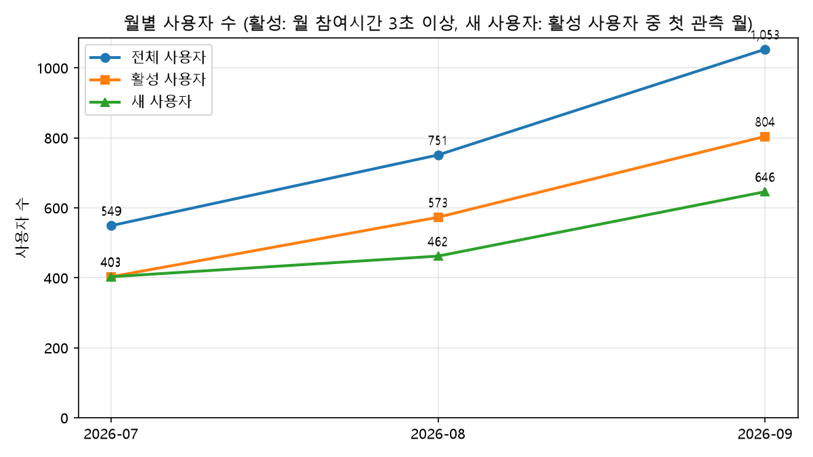

**그래프 설명**
- X축은 월, Y축은 사용자 수이고 선 3개를 한 그래프에 그렸습니다.
- 세 지표 모두 매달 증가합니다. 9월은 추석 기획전(9/14~9/27) 영향으로 신규 유입이 늘어난 것으로 보입니다.
- 7월에는 활성 사용자와 새 사용자가 같습니다(403명). 데이터가 7월부터라 모든 활성 사용자가 그 달에 처음 관측되기 때문입니다.
- 두 선의 간격이 벌어지는 것은 8~9월에 기존 사용자의 재방문이 늘었다는 뜻입니다.

### 4-3. AARRR 지표

계산 가능한 지표를 AARRR 단계별로 나눠 정의하고 대시보드에 구현했습니다. 정의는 'AARRR 지표 정의서'를 기준으로 했습니다.

| 단계 | 지표 |
|:--|:--|
| **Acquisition** | 채널별 새 사용자 수, 채널별 세션 수·비중, 캠페인별 유입, 유입 품질(채널별 참여 세션 비율) |
| **Activation** | 신규 사용자 활성화율(첫 세션 상품 조회), 첫 세션 장바구니 담기율, 세션당 페이지뷰, 세션당 평균 참여 시간 |
| **Retention** | N일 재방문율(7·14·30일), 채널별 재방문율 |
| **Revenue** | 구매 전환율(세션/사용자), 매출, AOV, 결제수단별 전환율, 채널별 매출·전환율·세션당 매출, 쿠폰 사용률·할인액, 카테고리·상품별 매출, ARPU, ARPPU |
| **Referral** | 공유·초대 이벤트가 없어 직접 측정 불가 → Referral 채널의 유입·전환·참여율·재방문율을 다른 채널과 비교 |

**공통 기준**: 시간은 KST, 채널은 세션의 마지막 클릭 기준 채널 그룹입니다. 카카오톡(`channel_message`)은 GA4 기본 규칙상 Unassigned가 되므로 **Kakao Message 채널로 따로 분리**했습니다. 새 사용자·재방문율을 채널별로 나눌 때는 사용자의 **첫 세션 채널**을 씁니다.

#### Acquisition — 유입

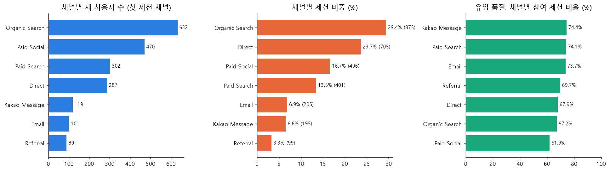

**그래프 설명**: 왼쪽부터 채널별 새 사용자 수, 세션 비중, 참여 세션 비율입니다.
Organic Search가 세션의 29.4%로 가장 많고 Direct(23.7%), Paid Social(16.7%)이 뒤를 잇습니다.
Paid Social은 새 사용자(470명)가 세션 수(496)와 거의 같아 **거의 한 번 오고 끝나는 유입**이며, 참여 세션 비율도 61.9%로 가장 낮습니다.
Paid Search·Email·Kakao Message는 참여 세션 비율이 73~74%로 높습니다.

| 채널 | 새 사용자 | 세션 | 세션 비중 | 참여 세션 비율 |
|:--|--:|--:|--:|--:|
| Organic Search | 632 | 875 | 29.4% | 67.2% |
| Direct | 287 | 705 | 23.7% | 67.9% |
| Paid Social | 470 | 496 | 16.7% | 61.9% |
| Paid Search | 302 | 401 | 13.5% | 74.1% |
| Email | 101 | 205 | 6.9% | 73.7% |
| Kakao Message | 119 | 195 | 6.6% | 74.4% |
| Referral | 89 | 99 | 3.3% | 69.7% |

#### Activation — 활성화

활성화 기준 행동은 '상품 상세 조회'로 정의했습니다(제안 기준).

| 지표 | 값 |
|:--|--:|
| 신규 사용자 활성화율(첫 세션에서 상품 상세 조회) | 63.9% |
| 첫 세션 장바구니 담기율 | 10.8% |
| 세션당 페이지뷰 | 3.45 |
| 세션당 평균 참여 시간 (0초 세션 포함) | 45.3초 |

신규 사용자의 약 64%가 첫 방문에서 상품 상세까지 보지만, 장바구니까지 가는 사용자는 약 11%입니다.

#### Revenue — 매출

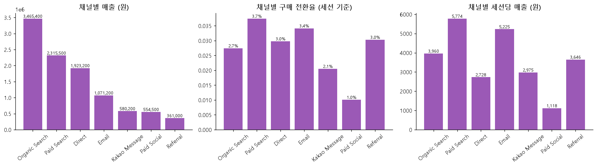

**그래프 설명**: 채널별 매출, 구매 전환율(세션 기준), 세션당 매출입니다.
Organic Search의 총매출이 가장 크지만(3,465,400원), 방문 1회당 가치를 보면 **Paid Search(5,774원)와 Email(5,225원)**이 가장 좋습니다.
Paid Social은 구매 5건, 전환율 1.0%, 세션당 1,118원으로 효율이 가장 낮습니다.

| 채널 | 구매 세션 | 구매 전환율 | 매출 | 세션당 매출 |
|:--|--:|--:|--:|--:|
| Organic Search | 24 | 2.7% | 3,465,400 | 3,960 |
| Direct | 21 | 3.0% | 1,923,200 | 2,728 |
| Paid Social | 5 | 1.0% | 554,500 | 1,118 |
| Paid Search | 15 | 3.7% | 2,315,500 | 5,774 |
| Email | 7 | 3.4% | 1,071,200 | 5,225 |
| Kakao Message | 4 | 2.1% | 580,200 | 2,975 |
| Referral | 3 | 3.0% | 361,000 | 3,646 |

| 매출 지표 | 값 |
|:--|--:|
| 매출 (배송비 제외, 환불 미차감) | 10,271,000원 |
| 주문 수 | 79건 |
| AOV | 130,013원 |
| 구매 전환율 (세션 / 사용자) | 2.65% / 3.85% |
| ARPU (전체 사용자당) | 5,136원 |
| ARPPU (구매자당) | 133,390원 |
| 쿠폰 사용률(주문) / 할인액 합계 | 16.5% / 126,000원 |

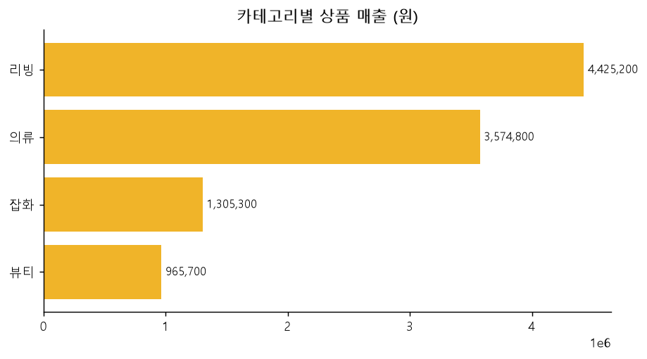

**그래프 설명**: 대분류별 상품 매출입니다. 리빙(4,425,200원)과 의류(3,574,800원)가 전체의 약 78%를 차지하고, 잡화·뷰티는 각각 13%·9% 수준입니다.

| 상품 매출 상위 5 | 매출 | 수량 | 주문 수 |
|:--|--:|--:|--:|
| 구스 경량 이불 | 1,852,200 | 10 | 8 |
| 워싱 린넨 침구 세트 Q | 1,773,100 | 12 | 9 |
| 라이트 트렌치코트 | 1,148,100 | 9 | 6 |
| 니트 가디건 | 708,000 | 12 | 10 |
| 데님 자켓 | 623,000 | 7 | 3 |

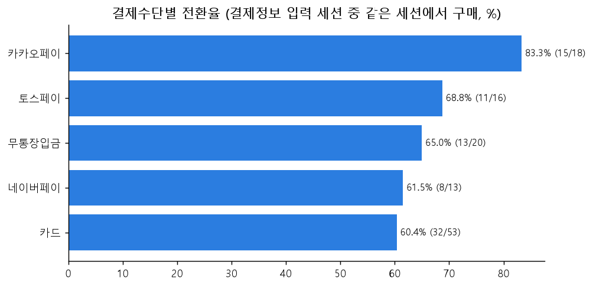

**그래프 설명**: 결제정보를 입력한 세션 중 **같은 세션에서 구매까지 이어진 비율**입니다(세션에서 마지막으로 고른 결제수단 기준).
카카오페이(83.3%)와 토스페이(68.8%) 같은 간편결제가 카드(60.4%)보다 높습니다. 괄호 안은 구매 수/결제정보 입력 수입니다.

| 결제수단 | 결제정보 입력 | 구매 | 전환율 |
|:--|--:|--:|--:|
| 카카오페이 | 18 | 15 | 83.3% |
| 토스페이 | 16 | 11 | 68.8% |
| 무통장입금 | 20 | 13 | 65.0% |
| 네이버페이 | 13 | 8 | 61.5% |
| 카드 | 53 | 32 | 60.4% |

모바일 세션만 보면 간편결제 도입일(2026-08-20) 전후로 결제정보 입력 → 구매 전환율이 **56.7%(17/30) → 64.4%(38/59)** 로 올랐습니다. 표본이 작아 방향성만 참고하세요.

#### Referral — 추천

공유·초대 이벤트가 없어 직접 측정이 불가능합니다. 대신 외부 링크로 들어온 Referral 채널을 비교했습니다.
Referral 세션은 99개(3.3%)로 적습니다. 전환율은 3.0%로 평균(2.65%)보다 약간 높고, 참여 세션 비율은 69.7%, 30일 재방문율은 39.2%로 전체 평균 수준입니다.
표본이 작아서 필터를 걸면 비율이 크게 흔들립니다.

### 4-4. 퍼널 분석

퍼널은 **세션 기준**이고, 단계 순서대로 발생한 세션만 다음 단계로 셉니다(이전 단계 이후에 발생한 이벤트만 인정).

**추천하는 5단계**

1. **세션 시작** (`session_start`): 모든 방문의 분모
2. **상품 상세 조회** (`view_item`): 구매 의도가 생긴 시점
3. **장바구니 담기** (`add_to_cart`): 구매 의도가 행동으로 확인되는 시점
4. **결제 시작** (`begin_checkout`): 장바구니에서 결제로 넘어간 시점
5. **구매 완료** (`purchase`)

결제 시작 이후의 세부 단계는 **결제 퍼널**(결제 시작 → 배송 정보 → 결제 정보 → 구매)로 따로 분석했습니다.

#### 구매 퍼널

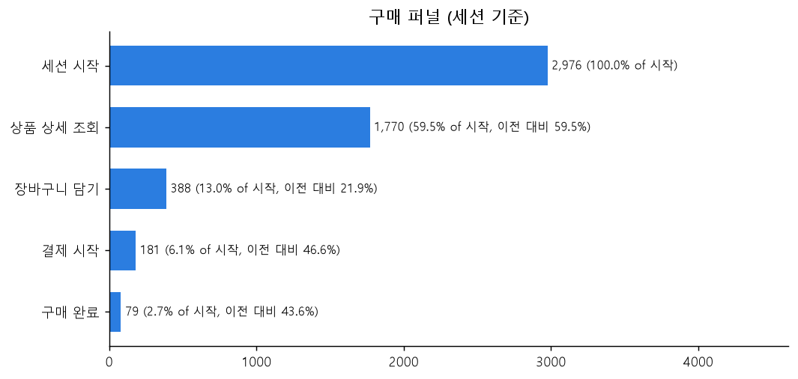

**그래프 설명**: 막대 길이는 단계에 도달한 세션 수이고, 오른쪽 숫자는 첫 단계 대비 비율과 이전 단계 대비 비율입니다.
세션 2,976개 중 상품 상세를 본 세션이 59.5%, 장바구니까지 간 세션이 13.0%, 구매까지 간 세션이 2.7%입니다.
**이전 단계 대비 비율이 가장 낮은 곳(21.9%)이 '상품 상세 → 장바구니 담기'** 로, 이탈 세션도 1,382개로 가장 많습니다.

| 단계 | 세션 수 | 첫 단계 대비 | 이전 단계 대비 | 이탈 세션 |
|:--|--:|--:|--:|--:|
| 세션 시작 | 2,976 | 100.0% | 100.0% | 0 |
| 상품 상세 조회 | 1,770 | 59.5% | 59.5% | 1,206 |
| 장바구니 담기 | 388 | 13.0% | 21.9% | 1,382 |
| 결제 시작 | 181 | 6.1% | 46.6% | 207 |
| 구매 완료 | 79 | 2.7% | 43.6% | 102 |

#### 결제 퍼널

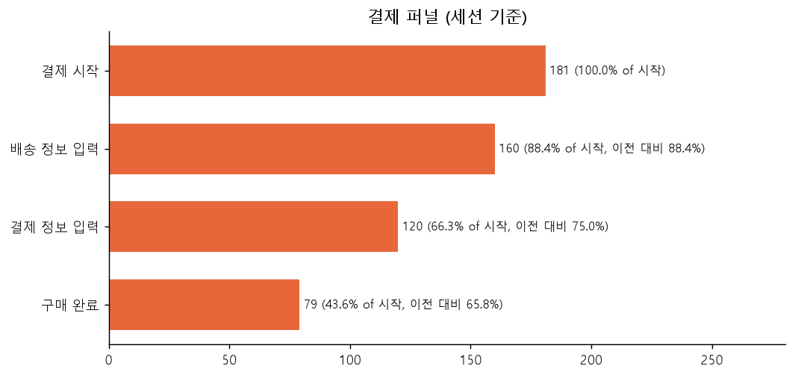

**그래프 설명**: 결제를 시작한 181개 세션이 어디서 빠지는지 보여줍니다.
이탈은 **결제 정보 입력 단계(40개)와 구매 직전(41개)에 비슷하게 크고**, 배송 정보 입력까지는 88.4%가 넘어갑니다. 결제수단을 고른 뒤 구매를 완료하지 않은 세션이 가장 아쉬운 구간입니다.

| 단계 | 세션 수 | 첫 단계 대비 | 이전 단계 대비 | 이탈 세션 |
|:--|--:|--:|--:|--:|
| 결제 시작 | 181 | 100.0% | 100.0% | 0 |
| 배송 정보 입력 | 160 | 88.4% | 88.4% | 21 |
| 결제 정보 입력 | 120 | 66.3% | 75.0% | 40 |
| 구매 완료 | 79 | 43.6% | 65.8% | 41 |

#### 추가 분석 1. 다음 단계를 하기 전에 이전 단계를 몇 번 수행했는가

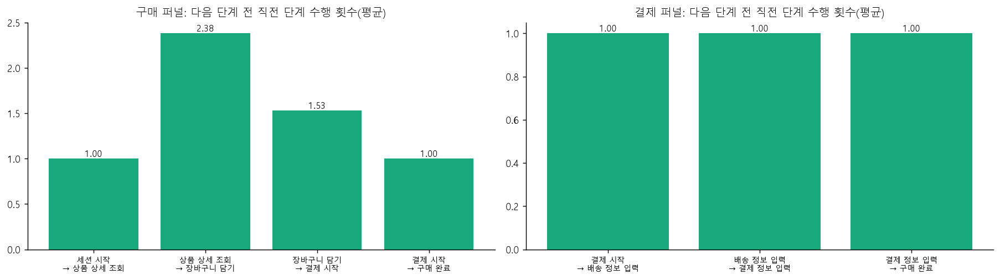

**그래프 설명**: 다음 단계에 도달한 세션에서, 그 시점까지 직전 단계 이벤트가 평균 몇 번 발생했는지입니다.
**장바구니에 담기 전에 상품 상세를 평균 2.38번 봅니다.** 한 번 보고 담는 세션은 40.7%뿐이고 20.4%는 4번 이상 봅니다. 즉 담기 전에 비교·망설임이 큽니다.
반대로 결제 시작 이후 단계(결제 퍼널)는 모두 1회로, 한 번 시작하면 단계를 반복하지 않습니다.

| 다음 단계 | 직전 단계 | 도달 세션 | 평균 횟수 | 중앙값 | 1회 | 2~3회 | 4회 이상 |
|:--|:--|--:|--:|--:|--:|--:|--:|
| 상품 상세 조회 | 세션 시작 | 1,770 | 1.00 | 1 | 100.0% | 0.0% | 0.0% |
| 장바구니 담기 | 상품 상세 조회 | 388 | 2.38 | 2 | 40.7% | 38.9% | 20.4% |
| 결제 시작 | 장바구니 담기 | 181 | 1.53 | 1 | 62.4% | 37.6% | 0.0% |
| 구매 완료 | 결제 시작 | 79 | 1.00 | 1 | 100.0% | 0.0% | 0.0% |

#### 추가 분석 2. 각 단계에서 다음 단계까지 걸린 시간

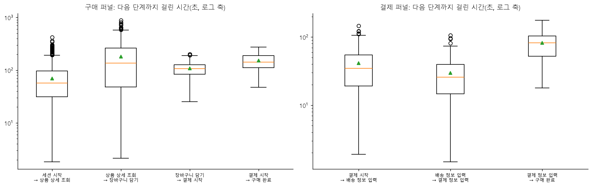

**그래프 설명**: 상자그림(박스플롯)입니다. 상자는 25~75% 구간, 주황색 선은 중앙값, 초록 삼각형은 평균이고 Y축은 로그 스케일(초)입니다.
**'상품 상세 → 장바구니 담기'가 가장 오래 걸리고(중앙값 135초) 편차도 큽니다.** 위쪽 점들은 최대 약 15분까지 고민한 세션입니다.
결제 퍼널은 배송 정보 입력이 가장 빠르고(26초), 결제 정보 입력 → 구매에 약 83초가 걸립니다.

| 구매 퍼널 구간 | 세션 수 | 평균(초) | 중앙값(초) | 75%(초) |
|:--|--:|--:|--:|--:|
| 세션 시작 → 상품 상세 조회 | 1,770 | 69 | 57 | 96 |
| 상품 상세 조회 → 장바구니 담기 | 388 | 180 | 135 | 264 |
| 장바구니 담기 → 결제 시작 | 181 | 108 | 106 | 126 |
| 결제 시작 → 구매 완료 | 79 | 152 | 143 | 189 |

| 결제 퍼널 구간 | 세션 수 | 평균(초) | 중앙값(초) | 75%(초) |
|:--|--:|--:|--:|--:|
| 결제 시작 → 배송 정보 입력 | 160 | 42 | 35 | 55 |
| 배송 정보 입력 → 결제 정보 입력 | 120 | 30 | 26 | 40 |
| 결제 정보 입력 → 구매 완료 | 79 | 82 | 83 | 103 |

### 4-5. 리텐션 분석

첫 방문일(첫 세션 날짜)을 0일로 두고, **N일째에 다시 방문한 사용자**를 셉니다(N-day 리텐션).
N일째가 데이터 마지막 시각(2026-09-30 23:04) 이후인 사용자는 그 N일의 분모에서 뺐습니다(9월 말 첫 방문자는 다시 올 시간이 부족하기 때문).

#### 리텐션 곡선

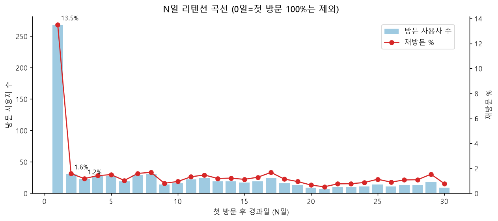

**그래프 설명**: X축은 첫 방문 후 경과일(N일), 왼쪽 Y축(막대)은 그날 방문한 사용자 수, 오른쪽 Y축(빨간 선)은 재방문 %입니다.
**D1(다음날)에 268명, 13.5%가 돌아오고 D2부터는 하루 20~30명(1~2%대)** 으로 급락해 이후 잔잔하게 이어지는 전형적인 모양입니다.
0일(100%)은 나머지 값이 안 보여서 그래프에서 제외했습니다.

| N일 | 방문 사용자 | 관찰 가능 사용자 | 재방문율 |
|--:|--:|--:|--:|
| 1 | 268 | 1,984 | 13.5% |
| 2 | 31 | 1,966 | 1.6% |
| 3 | 23 | 1,951 | 1.2% |
| 7 | 29 | 1,821 | 1.6% |
| 14 | 19 | 1,562 | 1.2% |

**N일 내 재방문율**(첫 방문 후 N일 안에 2번째 이후 세션이 있는 사용자 비율)

| 기간 | 재방문율 | 재방문 사용자 | 관찰 가능 새 사용자 |
|:--|--:|--:|--:|
| 7일 내 | 20.4% | 371 | 1,820 |
| 14일 내 | 27.6% | 431 | 1,559 |
| 30일 내 | 39.4% | 454 | 1,153 |

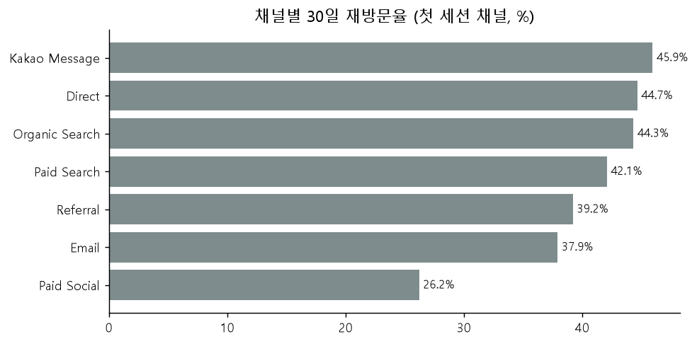

**그래프 설명**: 사용자의 첫 세션 채널별 30일 재방문율입니다. Kakao Message(45.9%), Direct(44.7%), Organic Search(44.3%)가 높고,
**Paid Social은 26.2%로 가장 낮습니다.** 유입 단계의 낮은 품질이 재방문에서도 확인됩니다. Email·Referral은 표본이 50명대라 해석에 주의가 필요합니다.

#### 리텐션 코호트 히트맵

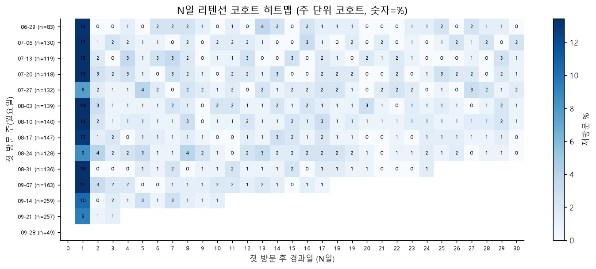

**그래프 설명**: X축은 첫 방문 후 경과일(N일), Y축은 첫 방문 주(코호트)이고, 칸의 색과 숫자는 그 코호트 사용자 중 N일째 다시 방문한 비율(%)입니다. 진할수록 재방문이 많습니다.
- 모든 코호트에서 **D1이 압도적으로 진하고**(8~19%) D2 이후는 거의 비슷한 옅은 색입니다.
- 아직 관찰할 수 없는 칸(N일째가 9/30 이후)은 비워 두어 오른쪽 아래가 삼각형 모양으로 비어 있습니다.
- 8/24와 7/27 코호트는 D1이 8~9%로 낮고, 7/20·8/3 코호트는 19%, 8/31 코호트는 18%로 높습니다.
- 색 범위는 0일(100%)을 제외하고 맞췄습니다.

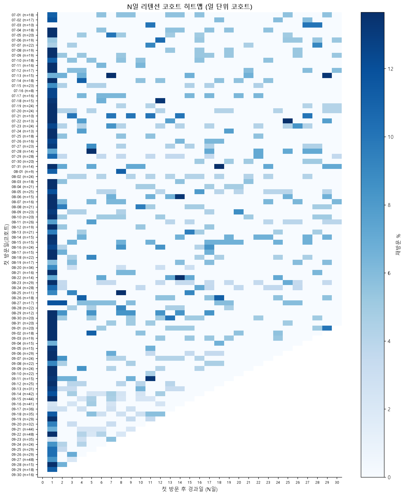

**그래프 설명**: 같은 차트를 일 단위 코호트로 그렸습니다. 일별 코호트는 하루 20여 명이라 칸마다 값이 크게 흔들리므로, 추세를 볼 때는 주 단위가 낫습니다. 대시보드에서는 두 가지를 전환해서 볼 수 있습니다.

---

## 5. Streamlit 대시보드

분석 결과를 필터로 바꿔 가며 볼 수 있도록 `dashboard/`에 4개 페이지로 만들었습니다. `output/`의 CSV만 읽기 때문에 원본 JSON 없이도 실행됩니다.

| 페이지 | 보여주는 것 | 조작할 수 있는 것 |
|:--|:--|:--|
| **AARRR** | Acquisition, Activation, Retention, Revenue, Referral 탭 5개. 지표 카드, 채널·카테고리 차트, 캠페인·상품 표 | 기간, 기기, 세션 채널 필터. 재방문 N일(7/14/30), 캠페인 표에서 organic·direct·referral 포함 여부 |
| **구매 퍼널** | 세션 시작 → 상품 상세 → 장바구니 → 결제 시작 → 구매 퍼널, 추가 분석 2개 | 기간, 기기, 세션 채널 필터. 직전 단계 수행 횟수 분포를 볼 단계 선택 |
| **결제 퍼널** | 결제 시작 → 배송 정보 → 결제 정보 → 구매 퍼널, 추가 분석 2개 | 구매 퍼널과 같음. 기간을 8/20 전후로 나눠 간편결제 도입 효과를 볼 수 있음 |
| **리텐션** | N일 리텐션 곡선(사용자 수 막대 + 재방문 % 선), 코호트 히트맵 | 첫 세션 기기·채널, 최대 N일(7~60), 코호트 단위(일/주) |

**계산 방식**
- 퍼널은 세션 단위입니다. 각 단계를 **이전 단계 이후에 발생한** 이벤트로만 인정해서, 순서가 뒤바뀐 세션은 다음 단계로 세지 않습니다.
- 추가 분석 1은 다음 단계 도달 시점까지 직전 단계 이벤트 수를 세고, 추가 분석 2는 두 단계 최초 발생 시각의 차이(초)를 구합니다.
- 리텐션은 N일째가 데이터 마지막 시각 이후인 사용자를 그 N일의 분모에서 뺍니다. 재방문 세션은 필터와 상관없이 모든 세션에서 찾습니다.
- 채널은 세션의 마지막 클릭 기준이며 카카오톡(`channel_message`)은 Kakao Message로 분리했습니다.

**실행**

```bash
python -m streamlit run dashboard/app.py
```

**확인한 범위**: 5개 페이지 모두 헤드리스 테스트(`scripts/03_apptest.py`)에서 예외 없이 실행됩니다. 브라우저에서 직접 본 페이지는 리텐션과 구매 퍼널이고, AARRR·결제 퍼널·코호트 히트맵은 실행 오류 여부만 확인했습니다.

---

## 6. 실행 방법

### 준비
1. 파이썬 3.10 이상에서 패키지를 설치합니다.

```bash
pip install -r requirements.txt
```

2. 원본 데이터를 `data/lite/` 폴더에 둡니다. (용량 때문에 저장소에는 포함하지 않았습니다.)

```
data/lite/ga4_events_202607_lite.json
data/lite/ga4_events_202608_lite.json
data/lite/ga4_events_202609_lite.json
```

### 실행 순서 (저장소 루트에서)

```bash
python scripts/01_build_tables.py     # output/ 에 테이블 3개 생성 (결측 비율, 매출 비교 출력)
python scripts/02_users_monthly.py    # 월별 사용자 그래프
python scripts/06_make_figures.py     # README용 차트(docs/images)와 표 재생성
python -m streamlit run dashboard/app.py
```

> `output/`의 CSV가 이미 들어 있으므로 원본 JSON이 없어도 **대시보드와 06번 스크립트는 바로 실행**됩니다.
> 한글 차트는 `Malgun Gothic` 폰트를 사용합니다(Windows 기준). 다른 OS에서는 `scripts/*.py`의 폰트 이름을 바꿔 주세요.

---

## 7. BigQuery 실습 기록과 스크린샷 가이드

GA4 데이터는 BigQuery로 옮겨 SQL로 분석하는 방식이 일반적입니다. 이 저장소의 분석은 JSON 파일 기반이라 BigQuery가 필수는 아니고, 흐름을 익히려고 아래까지 직접 해봤습니다.

**직접 해본 것**
1. BigQuery 콘솔에서 새 프로젝트를 만들었습니다(결제 정보 없이 쓰는 샌드박스 모드).
2. 구글 공개 샘플 `bigquery-public-data.ga4_obfuscated_sample_ecommerce`(2020-11-01 ~ 2021-01-31)에 접속했습니다.
3. 하루치 샘플 쿼리를 실행해 결과를 확인했습니다.
4. 3개월 전체 쿼리와 결과 내보내기는 실행하지 않았습니다(결과가 수백 MB이고, 분석에는 이미 가진 JSON을 썼기 때문).

```sql
-- 하루치 샘플 1,000행 (실행함)
SELECT * FROM `bigquery-public-data.ga4_obfuscated_sample_ecommerce.events_20201101` LIMIT 1000

-- 3개월 전체 (실행 전 예상 처리량 확인 필요, 실행하지 않음)
SELECT *
FROM `bigquery-public-data.ga4_obfuscated_sample_ecommerce.events_*`
WHERE _TABLE_SUFFIX BETWEEN '20201101' AND '20210131'
```

> 공개 샘플은 구글 머천다이즈 스토어의 2020~2021년 데이터라, 이 저장소에서 분석한 몰메이트 데이터(2026년, 가상)와는 다릅니다.

**스크린샷으로 남기면 좋은 화면** (`docs/screenshots/`에 넣고 이 표에 링크를 걸면 됩니다)

| 순서 | 사이트·화면 | 캡처할 내용 |
|:--|:--|:--|
| 1 | [Google Analytics](https://analytics.google.com) 왼쪽 아래 **관리 → 제품 링크 → BigQuery 링크** | GA4와 BigQuery를 연결하는 메뉴 위치 |
| 2 | [BigQuery 콘솔](https://console.cloud.google.com/bigquery) 첫 화면 | 새 프로젝트와 상단의 **샌드박스** 표시 |
| 3 | 탐색기 → `bigquery-public-data` → `ga4_obfuscated_sample_ecommerce` | 공개 데이터셋과 `events_` 테이블 목록 |
| 4 | 쿼리 편집기 | 샘플 쿼리, **실행** 버튼, 결과 목록의 초록 체크 |
| 5 | 쿼리 결과 위 **결과 저장** | 로컬 JSON(10MB 한도)과 Google Drive JSONL(1GB 한도) 선택지 |
| 6 | 테이블 화면 **내보내기 → Cloud Storage** | 형식을 JSON(줄바꿈 구분)으로 고르는 화면 |
| 7 | 실행 중인 대시보드(`localhost:8501`) | AARRR, 구매 퍼널, 결제 퍼널, 리텐션 페이지 전체 화면 |

---

## 8. 한계와 남은 쟁점

**데이터 한계**
- 3개월 데이터라 재구매자가 적고, 30일보다 긴 리텐션은 표본이 작습니다.
- 사용자는 로그인 ID가 아니라 **기기 단위**(`user_pseudo_id`)입니다. 한 사람이 여러 기기를 쓰면 여러 명으로 셉니다.
- 공유·초대 이벤트가 없어 Referral(추천)을 직접 측정하지 못하고 Referral 채널로 대신 봤습니다.
- 구매 79건, 결제정보 입력 120건이라 결제수단별·기간별 비교는 방향성만 참고해야 합니다. Referral은 세션 99개뿐입니다.

**지표 정의에서 정해야 할 쟁점**

| # | 쟁점 | 이 저장소의 선택 |
|:--|:--|:--|
| 1 | 새 사용자 정의 | 월별 그래프는 '활성 사용자 중 그 달 첫 관측', 대시보드는 `ga_session_number = 1`로 서로 다릅니다. 하나로 통일 필요 |
| 2 | 활성화 기준 행동 | 상품 상세 조회 (장바구니 담기는 별도 지표) |
| 3 | 재방문 기간 N과 분모 | 30일 기본(7·14·30 선택), 관찰 기간이 모자란 사용자 제외 |
| 4 | 구매 전환율 분모 | 세션 기준과 사용자 기준 둘 다 표시, 채널 비교는 세션 기준 |
| 5 | 매출 기준 | 배송비 제외, 환불 미차감(환불 1건, 247,000원) |
| 6 | ARPU와 ARPPU | 둘 다 표시 |
| 7 | 참여 시간 0초 세션 | 평균에 포함 |
| 8 | 결제수단 전환 범위 | 같은 세션 안의 구매만 인정 |

**데이터에 담긴 상황** (해석에 참고)
- 8/20 모바일 간편결제 도입
- 9/14~9/27 추석 기획전으로 신규 유입 급증
- 무료배송 기준 5만 원, 추석 기간 쿠폰 `CHUSEOK10`
